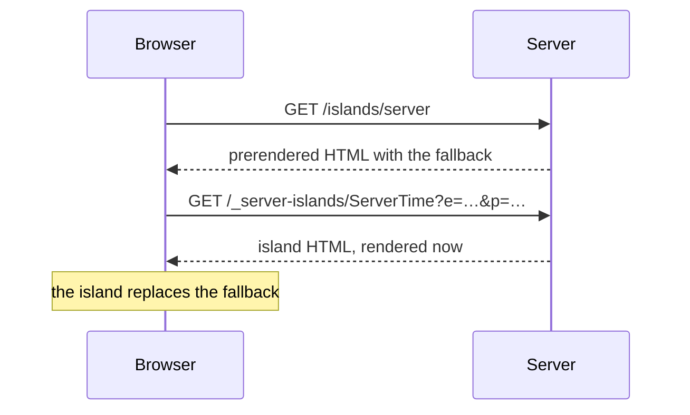

# Islands

Astro renders components to HTML and sends no JavaScript for them by default. An island is a part of the page that opts out of that: a client island hydrates in the browser, a server island renders on the server after the page has been sent.

**In this repo:** `/islands/client` shows each client directive on the same `Counter` component, `/islands/server` defers `ServerTime` with `server:defer`.

## Client islands

A UI framework component (Preact here) becomes interactive only with a `client:*` directive. Without one, it is plain HTML and its button does nothing.

```astro
<Counter label="No directive" />
<Counter client:load label="client:load" />
<Counter client:idle label="client:idle" />
<Counter client:visible label="client:visible" />
<Counter client:media="(max-width: 40rem)" label="client:media" />
<Counter client:only="preact" label="client:only">
  <p slot="fallback">client:only renders nothing on the server.</p>
</Counter>
```

| Directive        | Hydrates                                               |
| ---------------- | ------------------------------------------------------ |
| none             | never; static HTML                                     |
| `client:load`    | right away                                             |
| `client:idle`    | when the browser is idle (`timeout` option)            |
| `client:visible` | when the component scrolls into view (`rootMargin`)    |
| `client:media`   | when the media query matches                           |
| `client:only`    | right away, and skips server rendering (fallback slot) |

Each island hydrates on its own, so a slow one does not hold up the others. The counter label switches from "static HTML" to "interactive" once its island has hydrated.

## Server islands

`server:defer` turns an Astro component into a server island. The page is sent without it, showing the `fallback` slot, and the browser then fetches the island's HTML from the server.

```astro
<ServerTime server:defer greeting="Hello from the page">
  <p slot="fallback">Loading the server island…</p>
</ServerTime>
```



The page itself is prerendered, so the shell can be cached like any static file, while the island is rendered per request. This is Astro's answer to the dynamic holes that Next.js fills with Suspense and streaming.

## Good to know

- **A server island is its own route.** Inside it, `Astro.url.pathname` is `/_server-islands/ServerTime`, not the page's URL. Read the page URL from the `Referer` header, as `ServerTime` does. The route is one of Astro's [reserved routes](route-priority.md).
- **Props travel in the URL, encrypted.** They are serialized, encrypted and sent in the query string. Above 2048 bytes the request switches to POST, which browsers do not cache, so pass only what the island needs. Functions can't be props.
- **The encryption key changes with every build.** With several server instances or a CDN in front, generate a fixed key with `astro create-key` and set it as `ASTRO_KEY`, or one instance can't decrypt another's props.
- **Server islands need an adapter**, because something has to render them per request. Client islands work on a fully static site.

Reference: [Islands architecture](https://docs.astro.build/en/concepts/islands/), [Server islands](https://docs.astro.build/en/guides/server-islands/), [Template directives](https://docs.astro.build/en/reference/directives-reference/)
