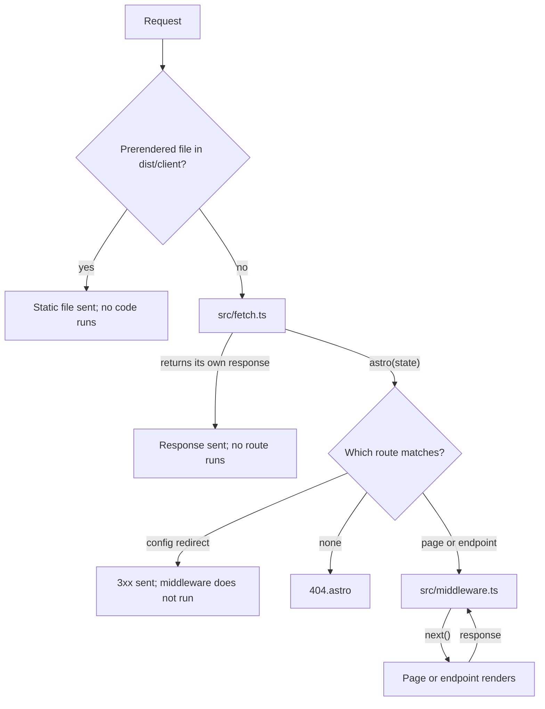

# Request pipeline

Two files can run code around routing. `src/fetch.ts` is the server's entry point and sees a request before Astro matches a route. `src/middleware.ts` runs once a route has matched, around the page or endpoint that renders it.

**In this repo:** `src/fetch.ts` answers `/healthz` itself and redirects `/admin` to `/`. `src/middleware.ts` reads a stand-in session for `/account` and adds a `Server-Timing` header.

## Where each one runs



## src/fetch.ts

```ts
// src/fetch.ts
import type { Fetchable } from 'astro';
import { FetchState, astro } from 'astro/fetch';

export default {
  async fetch(request: Request): Promise<Response> {
    const { pathname } = new URL(request.url);

    // Answered here, so no route, middleware or page is involved.
    if (pathname === '/healthz') return new Response('ok');

    if (pathname === '/admin' || pathname.startsWith('/admin/')) {
      return new Response(null, { status: 307, headers: { Location: '/' } });
    }

    // Everything else goes through Astro's full pipeline.
    return astro(new FetchState(request));
  },
} satisfies Fetchable;
```

`astro()` runs the whole built-in pipeline. For finer control, `astro/fetch` also exports its stages (`actions`, `middleware`, `pages`, `i18n` and others) to call in your own order, and `astro/hono` exports the same stages as Hono middleware. Without `src/fetch.ts`, Astro behaves as if the file only called `astro()`.

This is the closest match to the Next.js `proxy.ts`: both see the raw request before routing. One difference: Next.js runs Proxy for static assets too unless its matcher excludes them, while `src/fetch.ts` never sees files that the server sends from `dist/client`.

## src/middleware.ts

```ts
// src/middleware.ts
import { defineMiddleware, sequence } from 'astro:middleware';

const session = defineMiddleware((context, next) => {
  // Prerendered pages run middleware once, at build time.
  const as = context.isPrerendered ? null : context.url.searchParams.get('as');
  context.locals.user = as === 'admin' || as === 'user' ? { role: as } : null;
  return next();
});

const timing = defineMiddleware(async (context, next) => {
  const start = performance.now();
  const response = await next();
  if (!context.isPrerendered) {
    const ms = (performance.now() - start).toFixed(1);
    response.headers.set('Server-Timing', `render;dur=${ms}`);
  }
  return response;
});

export const onRequest = sequence(session, timing);
```

- `context.locals` carries data to the page. Its type comes from `App.Locals` in `src/env.d.ts`, so `Astro.locals.user` is typed in `/account`.
- `sequence()` chains middleware. Code before `next()` runs on the way in, code after it on the way out.
- Middleware can also redirect, rewrite with `context.rewrite()` or return its own `Response`.

## Good to know

- **Middleware runs at build time for prerendered pages.** There is no real request then: no cookies, no client headers, a query string that is always empty. `context.isPrerendered` tells the two cases apart.
- **Neither file sees prerendered pages at request time.** The server sends their files before `src/fetch.ts` runs, so checks there or in middleware do not protect them. Protected pages need `prerender = false`.
- **Config redirects skip middleware.** `/old-about` is answered before `onRequest` runs, so a redirect can't be guarded or logged there. `src/fetch.ts` does see it.
- **Routes handled in `src/fetch.ts` are invisible to Astro.** `/healthz` is not in the route map, and no type or tool knows it exists.
- **Not an authorization layer on its own.** As with Next.js Proxy, check permissions where data is read or changed; `/account` decides its own status from `Astro.locals.user`.

Reference: [Middleware](https://docs.astro.build/en/guides/middleware/), [Advanced routing](https://docs.astro.build/en/guides/routing/#advanced-routing)
