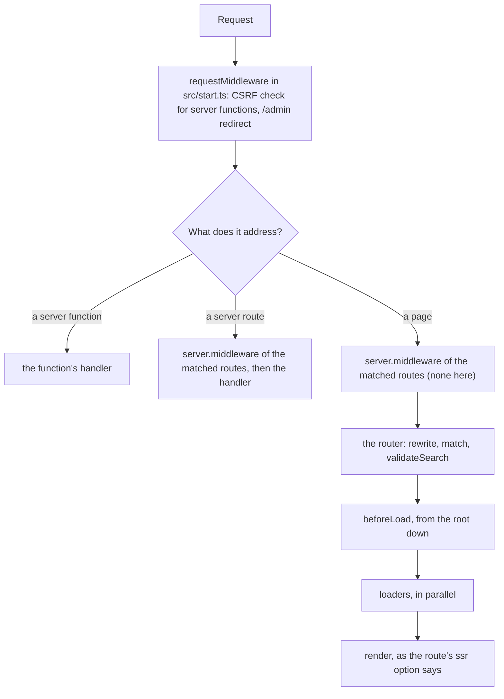

# Request pipeline

Code can run at three points before a page renders: request middleware in `src/start.ts`, for every request; a route's `server.middleware`, for requests that match the route (not shown here); and `beforeLoad`, on the server for the first request and in the browser on client navigation.

**In this repo:** `src/start.ts` and `src/routes/account.tsx`.

## Flow



## Request middleware

`src/start.ts` registers middleware that runs for every request that reaches the server: pages, server routes and server functions. It can answer directly with a `Response` or pass the request on with `next()`:

```ts
const adminRedirect = createMiddleware().server(({ request, next }) => {
  const { pathname } = new URL(request.url);
  if (pathname === '/admin' || pathname.startsWith('/admin/')) {
    return new Response(null, { status: 307, headers: { Location: '/' } });
  }
  return next();
});
```

`/admin` and `/admin/users` get a 307 to `/`, the same as the Next.js proxy and the Astro fetch demos.

### CSRF

Server functions are same-origin calls. Without `src/start.ts`, Start rejects cross-site calls to them by itself. Once the file exists, only the middleware it lists runs, so it adds the check again:

```ts
const csrf = createCsrfMiddleware({
  filter: (ctx) => ctx.handlerType === 'serverFn',
});

export const startInstance = createStart(() => ({
  requestMiddleware: [csrf, adminRedirect],
}));
```

A request to the products server function with `Sec-Fetch-Site: cross-site` gets a 403. In dev, Start warns when `src/start.ts` has no CSRF middleware.

## beforeLoad

`beforeLoad` runs before the route's loader and component, for every matched route from the root down. It can redirect, throw `notFound()`, or add to the route context:

```tsx
// src/routes/account.tsx
beforeLoad: ({ search }) => {
  if (!search.as) throw redirect({ to: '/login' });
  return { role: search.as };
},
```

`/account` gets a 307 to `/login` from the server; on client navigation the same redirect is a client-side navigation. `/account?as=admin` renders, and the component reads the role with `Route.useRouteContext()`.

## Good to know

- **beforeLoad is a guard, not authorization.** It also runs in the browser, where it can be bypassed. Check access in server functions, server routes or request middleware.
- **Prerendered files skip the server.** On a static host, the files in `dist/client` are served without any middleware running.

Reference: [Middleware](https://tanstack.com/start/latest/docs/framework/react/guide/middleware), [Authenticated routes](https://tanstack.com/router/latest/docs/framework/react/guide/authenticated-routes)
