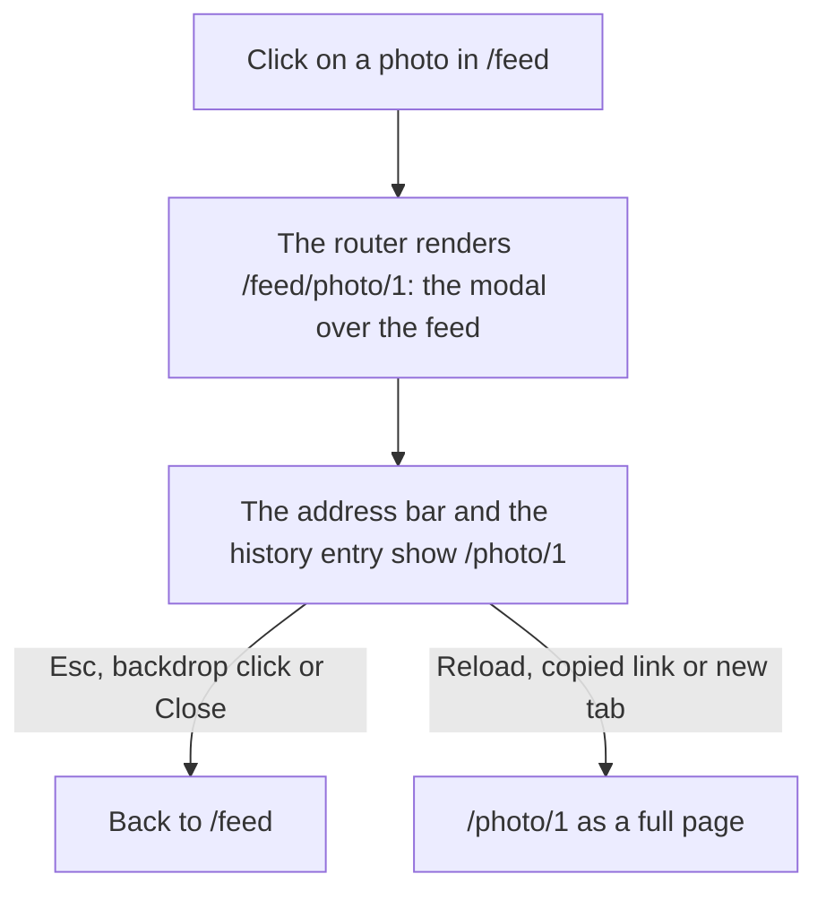

# Route masking

Route masking renders one route while the address bar and the history entry show another URL. It is TanStack Router's answer to Next.js intercepting routes: a photo opens as a modal over the feed, and its URL is the photo's own page.

**In this repo:** open `/feed` and click a photo. `/photo/1` appears in the address bar and the photo opens as a modal over the feed; reload, and the full page from `src/routes/photo/$id.tsx` renders instead.

## Structure

```
src/routes/
├─ feed/
│  ├─ route.tsx             → /feed: the grid and an <Outlet />
│  └─ photo/
│     └─ $id.tsx            → /feed/photo/1: the modal, in the feed's outlet
└─ photo/
   └─ $id.tsx               → /photo/1: the full page
```

## The link

The feed links to its own child route and masks it with the full page's URL:

```tsx
<Link
  to="/feed/photo/$id"
  params={{ id }}
  mask={{ to: '/photo/$id', params: { id }, unmaskOnReload: true }}
>
```

The link's `href` is the masked URL, so "open in new tab" and a copied link go straight to the full page.

## Flow



## The modal

`feed/photo/$id.tsx` renders a native `<dialog>` opened with `showModal()`, which brings Esc support and an inert page behind it. Every way of closing first calls `dialog.close()`, which returns focus to the photo link, then goes back in history, or to `/feed` when there is no entry to go back to (`useCanGoBack()`), for example after a direct load of `/feed/photo/1`.

## Good to know

- **Set `unmaskOnReload` when the app renders on the server.** The mask lives only in the browser's history state. A reload sends `/photo/1` to the server, which renders the full page, while by default the browser restores the modal: React reports a hydration mismatch (error 418). With `unmaskOnReload: true` both sides render the full page, which is also what Next.js does.
- **`/feed/photo/1` is a real URL.** Loaded directly, it shows the modal over the feed.
- **Nothing in the file system marks a mask.** Any link can mask any route, and `createRouteMask()` with the router's `routeMasks` option sets masks in one place.

Reference: [Route masking](https://tanstack.com/router/latest/docs/framework/react/guide/route-masking)
